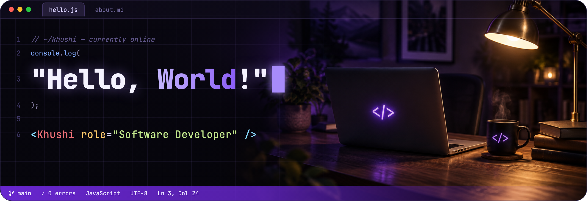

[README.md](https://github.com/user-attachments/files/34866976/README.md)


  
</p>

<p align="center">
  <a href="https://www.linkedin.com/in/YOUR-LINKEDIN"></a>
  <a href="https://www.instagram.com/_khushi.panu"></a>
  <a href="mailto:YOUR-EMAIL"></a>
  <a href="https://moviethrill.vercel.app/"></a>
</p>

<br />

### Hey there 👋

I'm Khushi, a MERN stack developer. I mostly live in React (Redux, custom hooks, component architecture), with Node, Express and MongoDB behind it.

Right now I work at **Ruhanix**, where I'm helping build an ERP that handles sales, production, costing and HR for a manufacturing business. Outside work, I'm building my own **LMS**, and when I'm not coding I make content on [Instagram](https://www.instagram.com/_khushi.panu).

```text
📍 now       →  building an ERP at Ruhanix
🛠️ side      →  a full-stack LMS (MERN)
🎬 shipped   →  MovieThrill
🤝 open to   →  freelance, collabs & new roles
```

<br />

### 🧰 What I work with

<p align="left">
  
  <br />
  
</p>

<br />

### 🎬 MovieThrill

<a href="https://moviethrill.vercel.app/">
  
</a>

A movie and TV show discovery app built on the TMDB API.

- **Trending, Popular, Movies, TV Shows & People** each get their own feed
- **Search** across movies, shows and people from one bar
- **Filter** the trending list by Movie / TV / All
- **Watch trailers** without leaving the app
- **Redux** handles global state; the UI is split into reusable React components

`React` `Redux` `JavaScript` `TMDB API` `Vercel` &nbsp;·&nbsp; **[Open the live site →](https://moviethrill.vercel.app/)**

<br />

### 🎓 Learning Management System &nbsp; 

A full-stack LMS for running courses: managing students, courses and learning content in one place.

`MongoDB` `Express` `React` `Node.js`

<br />

### 📈 Activity

<p align="center">
  
</p>

<br />

<p align="center">
  
</p>
98-943ef4f74d41" />
## Hi there 👋

<!--
**Khushipanu/khushipanu** is a ✨ _special_ ✨ repository because its `README.md` (this file) appears on your GitHub profile.

Here are some ideas to get you started:

- 🔭 I’m currently working on ...
- 🌱 I’m currently learning ...
- 👯 I’m looking to collaborate on ...
- 🤔 I’m looking for help with ...
- 💬 Ask me about ...
- 📫 How to reach me: ...
- 😄 Pronouns: ...
- ⚡ Fun fact: ...
-->
