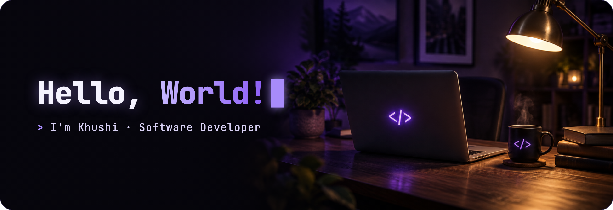

  

  
  
  
  

 

## 👩‍💻 About Me

I'm Khushi, a **software developer** who enjoys building clean, fast and useful web applications. I work mainly with the **MERN stack**: React and Redux on the frontend, and Node.js, Express and MongoDB on the backend.

Alongside development, I regularly practice **Data Structures & Algorithms** to sharpen my problem-solving and write more efficient code. I like understanding how things work under the hood, picking up new tools, and turning ideas into real, working products.

I'm always open to collaborations, freelance work and new opportunities, so feel free to reach out.

 

## 🧰 Tech Stack

  
   
  

 

## 📊 GitHub Stats

  
  

  

 

